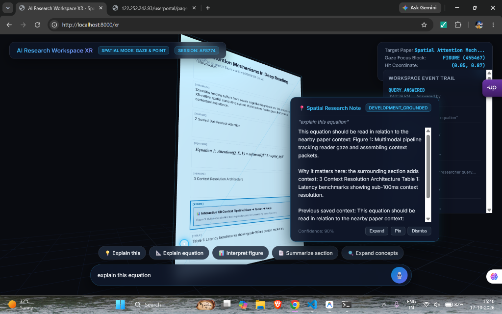
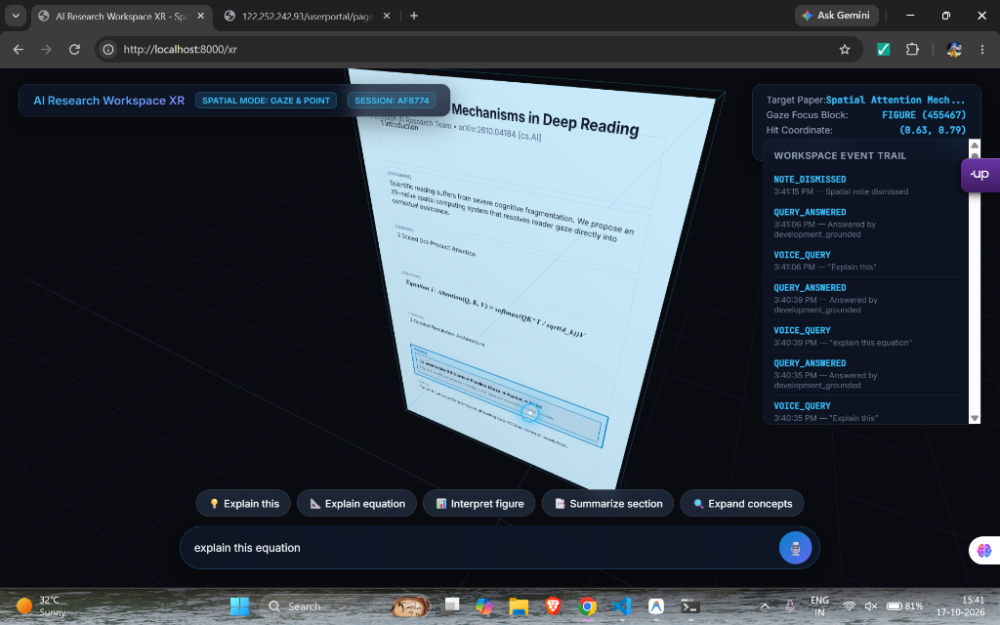
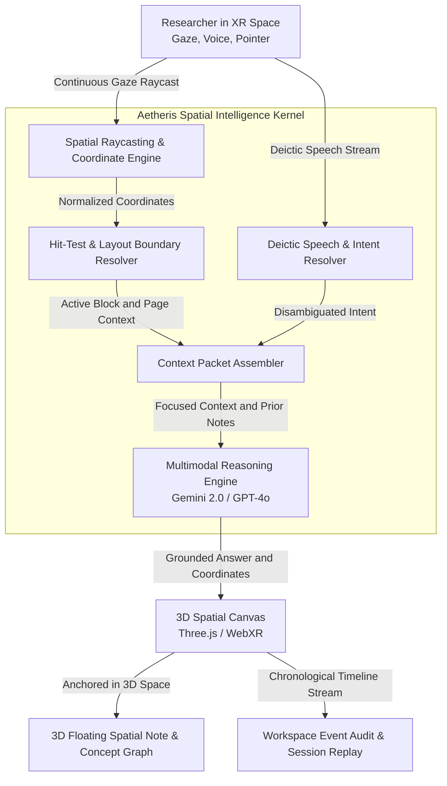

# Aetheris XR 🌌
### The Spatial Research Operating Environment

> **Aetheris is not another PDF chatbot.**  
> It is an immersive, context-aware spatial computing platform where researchers interact with scientific documents in 3D space, and AI understands user gaze, pointer coordinates, deictic voice commands, and document layout in real time.

---

## 📸 Interactive 3D Spatial Interface

  
  
<em>Figure 1: Gaze raycasting hits an equation on the 3D vector-rendered document, materializing a grounded floating Spatial Note anchored in 3D world space.</em>

 

  
  
<em>Figure 2: Real-time gaze reticle coordinate hit-testing `(0.63, 0.79)` against document blocks with a live chronological session event trail.</em>

---

## 💡 The Core Problem

Modern academic and scientific research workflows suffer from **severe cognitive fragmentation**:

* **Working Memory Saturation**: Researchers constantly juggle between PDF readers, Google Scholar, ChatGPT, GitHub, Overleaf, and citation managers. Every context switch shatters deep focus.
* **The "Prompt Fatigue" Tax**: When reading a complex 30-page paper with 50 equations, conventional AI chatbots force you to manually explain context:
  > *"In Equation 4 on page 7 where $\lambda$ is defined, what does the third term mean in the context of section 3.2?"*
* **Flat 2D Screen Cramping**: Complex papers require cross-referencing figures from page 3, proofs from page 12, and baseline methods from another paper simultaneously. 2D monitors cannot hold this mental workspace.

---

## ⚡ The Aetheris Solution: "Look & Ask"

Aetheris replaces high-friction copy-paste chat with **Zero-Friction Spatial Cognition**:

1. **Gaze & Raycast Hit-Testing**: Wear an XR/VR headset (or use the spatial desktop simulator) and read naturally. A continuous spatial raycaster maps your gaze point `(x, y)` to the exact content block (paragraph, equation, figure, table).
2. **Deictic Voice Disambiguation**: Simply look at an equation, curve, or ablation table and say:
   * 🎙️ *"Explain this"*
   * 🎙️ *"Why is this equation scaled by $\sqrt{d_k}$?"*
   * 🎙️ *"What does this graph prove?"*
   * 🎙️ *"Summarize this section"*
3. **3D Floating Spatial Notes**: The grounded explanation materializes directly beside the focused content in 3D space. Notes can be **Pinned**, **Expanded into 3D Concept Graphs**, or **Dismissed**.
4. **Authentic Vector Rendering**: Integrated with Mozilla's PDF.js vector engine, rendering uploaded PDFs with 100% typography, layout, and mathematical fidelity.

---

## 🏛️ High-Level System Architecture

---

## 🌟 Key Platform Capabilities

| Feature | Description |
| :--- | :--- |
| **High-Fidelity PDF.js Vector Engine** | Renders uploaded scientific PDFs with 100% vector fidelity—fonts, mathematical equations, bold headings, and layouts remain completely intact. |
| **Sub-100ms Gaze Hit-Testing** | High-performance spatial hit-testing maps 2D/3D gaze points to document blocks with nearest-neighbor fallback. |
| **Deictic Intent Disambiguation** | Resolves demonstrative pronouns (*"this"*, *"that"*, *"here"*) against the active visual context, prompting for clarification only when ambiguity is high. |
| **Multi-Page Spatial Pager** | Smooth multi-page navigation across dense documents using floating spatial controls or keyboard shortcuts (`←` / `→`). |
| **Dynamic AI Engine Gateway** | Switch effortlessly between **Google Gemini (Gemini 2.0 Flash / Pro)**, **OpenAI (GPT-4o)**, local models via **Ollama**, or deterministic offline stubs. |
| **3D Concept Expansion** | Transforms complex equations and figures into multi-panel spatial breakdowns and interconnected concept nodes. |
| **Multi-Paper Comparison** | Simultaneously anchor two papers in 3D space and generate side-by-side comparative analyses across methodologies. |
| **Session Replay & Timeline Trail** | Every interaction, gaze focus, voice query, and note transition is recorded in a chronological session timeline for retrospective replay. |

---

## 🖥️ Live WebXR Interactive Demo

You can experience the 3D spatial reading environment right inside your browser or XR headset:

1. Open the [**Interactive WebXR Simulator**](demo/index.html) (available via GitHub Pages).
2. Move your mouse/gaze across the 3D paper surface.
3. Observe the cyan reticle and the live gaze coordinate updates in the top-right HUD.
4. Click any intent chip (e.g., *"💡 Explain this"*, *"📐 Explain equation"*) to witness 3D spatial note anchoring in real time.

---

## 🗺️ Engineering Roadmap

- [x] **Phase 1: Foundation & Spatial Spine** — Coordinate hit-testing, active context resolution, and event logging.
- [x] **Phase 2: Intent Resolution & Context Assembly** — Deictic reference parsing and multi-block context packaging.
- [x] **Phase 3: Multimodal AI Integration** — Live Gemini 2.0 Flash and GPT-4o adapter boundaries with resilient offline fallback.
- [x] **Phase 4: High-Fidelity Vector Document Engine** — PDF.js integration and decoupled 3D highlight meshes.
- [ ] **Phase 5: Native OpenXR / VisionOS Client** — Porting the 3D spatial pipeline to native Apple Vision Pro and Meta Quest 3 headsets.
- [ ] **Phase 6: Multi-User Spatial Collaboration** — Shared research rooms where multiple scientists can explore, annotate, and debate papers in mutual 3D space.

---

## 📄 Intellectual Property & License

**Copyright © 2026 FedVision AI Research Team / Bhoopendra Singh Bhadauria. All Rights Reserved.**

This repository serves as a **public showcase, specification, and conceptual preview** of the Aetheris Spatial Research Platform. The underlying proprietary core engine, algorithms, and production deployment code are maintained in a private repository (`aetheris-core`).

Unauthorized copying, distribution, reverse engineering, or commercial reproduction of the architecture and software designs is strictly prohibited. For licensing inquiries, commercial partnerships, or academic collaboration:
* **Lead Researcher**: Bhoopendra Singh Bhadauria
* **Contact**: [bhoopendrasinghbhadauria5@gmail.com](mailto:bhoopendrasinghbhadauria5@gmail.com)
* **Organization**: FedVision Research Team
