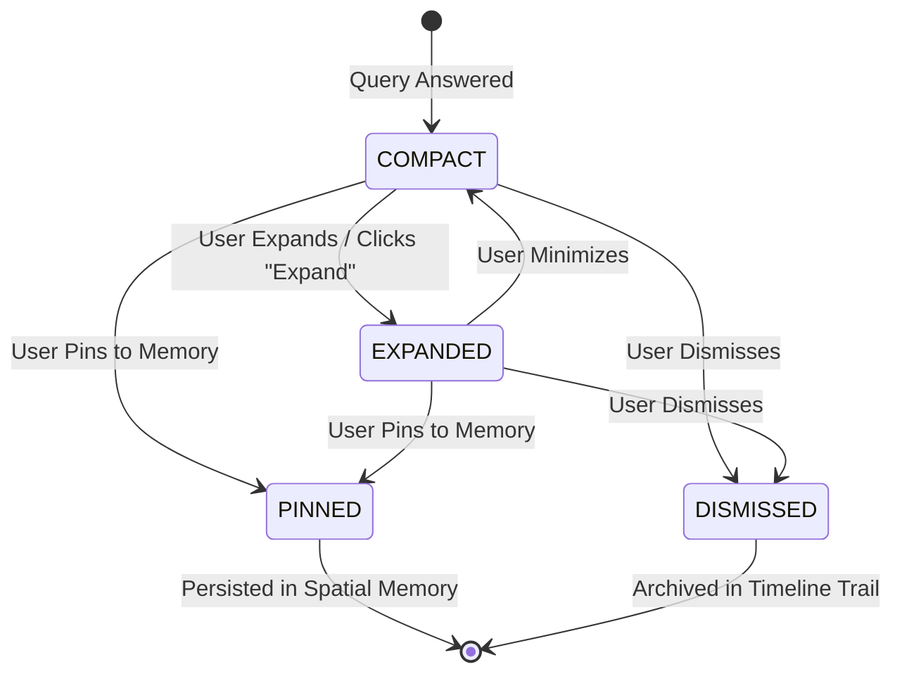

# Aetheris Platform: High-Level Specifications

---

## 1. Spatial Coordinate Frame & Hit-Testing

### 1.1 Normalized Document Space
All documents rendered in 3D space are mapped to a normalized 2D coordinate space:
$$\mathcal{S} = \{ (u, v) \in \mathbb{R}^2 \mid 0 \le u \le 1, \, 0 \le v \le 1 \}$$
* Origin $(0, 0)$: Top-left corner of the document page.
* Bottom-right $(1, 1)$: Bottom-right corner of the document page.

### 1.2 Continuous Gaze Raycasting
* **Input**: Camera/Eye Origin $\vec{O} \in \mathbb{R}^3$, Gaze Vector $\vec{D} \in \mathbb{R}^3$, Document Plane Quad in 3D space.
* **Hit Point Calculation**: Computes 3D intersection point and maps via UV bilinear interpolation to $(u, v) \in \mathcal{S}$.
* **Nearest-Neighbor Fallback**: If $(u, v)$ falls into inter-paragraph margins, the resolver computes Euclidean distance to all block bounding boxes on the page and selects the nearest block if within $\epsilon = 0.08$ threshold.

---

## 2. Content Block Taxonomy

Aetheris decomposes academic literature into five structural block types:

```
                  ┌──────────────────────┐
                  │ ContentBlock (Page P) │
                  └──────────┬───────────┘
                             │
     ┌───────────┬───────────┼───────────┬───────────┐
     ▼           ▼           ▼           ▼           ▼
[ HEADING ] [PARAGRAPH] [ EQUATION ] [  FIGURE ] [  TABLE  ]
Section     Narrative   Mathematical Graphical   Structured
Title       Body Text   Formalism    Schematic   Benchmark
```

* **HEADING**: Structural section delimiters (e.g., *1 Introduction*, *3 Methodology*).
* **PARAGRAPH**: Narrative expository text blocks.
* **EQUATION**: LaTeX / mathematical expressions requiring parameter interpretation and intuition.
* **FIGURE**: Graphical visual representations (loss curves, architecture diagrams, charts).
* **TABLE**: Tabular quantitative experimental data (hyperparameter grids, benchmark comparisons).

---

## 3. Spatial Note Lifecycle State Machine

Floating spatial notes exist as first-class 3D entities with four deterministic states:



* **COMPACT**: Small, high-density floating note offset by $(\Delta x = 0.08\text{m}, \Delta y = 0.0\text{m})$ relative to the block anchor.
* **EXPANDED**: Multi-panel contextual exploration view with assumption breakdowns and related literature links.
* **PINNED**: Anchored permanently to the document; saved into persistent research memory for cross-session recall.
* **DISMISSED**: Removed from the active visual field but preserved in the chronological event audit trail.

---

## 4. Deictic Intent Resolution

When speech transcripts contain demonstrative pronouns (*"this"*, *"that"*, *"it"*, *"here"*), the intent engine resolves the semantic target:

| Query Pattern | Inferred Action | Inferred Target |
| :--- | :--- | :--- |
| *"Explain this"* | `EXPLAIN` | Active Gaze Block (`EQUATION`, `PARAGRAPH`, or `FIGURE`) |
| *"What does this equation mean?"* | `EXPLAIN` | Current Focused `EQUATION` |
| *"What does this graph show?"* | `INTERPRET` | Current Focused `FIGURE` |
| *"Summarize this section"* | `SUMMARIZE` | Parent Section encompassing focused block |
| *"Compare this with that"* | `COMPARE` | Two resolved spatial context anchors |
| *"Expand into concepts"* | `EXPAND` | Generates 3D Concept Graph |

If gaze confidence drops below threshold $0.55$, the engine responds with a clarification query rather than guessing.

---

## 5. Event Audit & Session Timeline

Every user interaction produces a structured `WorkspaceEvent`:
* `SESSION_STARTED`
* `PAPER_ATTACHED_TO_SESSION`
* `CONTEXT_SET_FROM_POINT`
* `SPEECH_TRANSCRIBED`
* `QUERY_ANSWERED`
* `NOTE_UPDATED` (Pinned / Expanded / Dismissed)
* `EXPANSION_CREATED`

These events are ordered chronologically into `WorkspaceSessionTimeline` steps, enabling post-reading review, collaborative replay, and cognitive load analytics.
